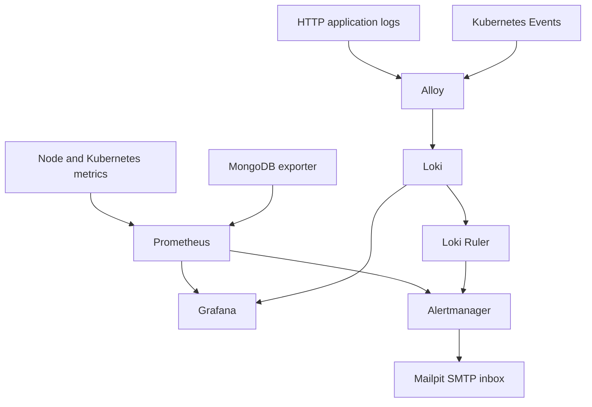

# Week 13 — Monitoring and Logging

## Architecture

The lab runs on a single AWS EC2 instance with K3s.
Terraform manages the infrastructure, while Helm and Kubernetes manifests
manage monitoring, logging and demonstration workloads.

## Task 1 — Infrastructure and MongoDB monitoring

The kube-prometheus-stack chart provides Prometheus, Grafana,
Alertmanager, node-exporter and kube-state-metrics.

MongoDB runs in the demo namespace. Its exporter exposes metrics through
a ServiceMonitor selected by Prometheus.

The dashboard is generated from monitoring/build-task1-dashboard.py
and provisioned through a ConfigMap.

| Signal | Purpose |
|---|---|
| Node CPU and memory usage | Identify resource saturation |
| Container usage, requests and limits | Compare consumption with resource configuration |
| Container restarts | Detect unstable workloads |
| Last termination reason: OOMKilled | Identify memory-related container termination |
| mongodb_up | Verify exporter connectivity to MongoDB |
| mongodb_asserts_total | Track assertion counters and their increases |
| Kubernetes Events in Loki | Investigate scheduling and workload problems |

MongoDB compatibility metrics are not added together with equivalent
modern exporter metrics, avoiding duplicate counting.

Infrastructure alert rules cover Node readiness, memory pressure,
disk pressure and container restarts following an OOM kill.

### Verified scenarios

- The OOM demonstration container terminated with OOMKilled, exit code 137.
- It restarted once and entered recovery mode.
- Week13ContainerOOMKilled fired and reached Alertmanager.
- The events-demo Pod generated FailedScheduling because its node selector
  matched no node.
- Alloy collected that Event and Grafana displayed it through Loki.

## Task 2 — Logging and notifications

Alloy collects container logs from the demo namespace and Kubernetes
Events from all namespaces.

Loki uses a single replica, filesystem storage on a 10 Gi PVC and
48-hour retention. Grafana queries Loki as a separate data source.

The HTTP demonstration application produces structured JSON logs.
The /ok endpoint returns HTTP 200 and /fail returns HTTP 500.
Health probe requests are excluded from access logs.

Week13HTTP5xxSpike evaluates application logs every 15 seconds.
It fires when at least 10 HTTP 5xx responses occur within a rolling
two-minute window and the condition persists for 30 seconds.

This is an absolute error-count threshold selected for the lab traffic.

### Notification verification

- A synthetic Prometheus alert verified SMTP delivery to Mailpit.
- The HTTP traffic Job provides baseline, failure and recovery phases.
- A FIRING email for Week13HTTP5xxSpike was received in Mailpit.
- Recovery was verified: the traffic Job completed successfully, the recovery phase returned 150 HTTP 200 responses, and a RESOLVED email for Week13HTTP5xxSpike was received in Mailpit.

Mailpit is the test SMTP receiver. Messages are inspected in its browser
interface; delivery to an external Gmail mailbox is outside this test.

## Access

Run each port-forward in a separate terminal:

    kubectl -n monitoring port-forward svc/week13-grafana 3000:80
    kubectl -n monitoring port-forward svc/mailpit 8025:8025

- Grafana dashboard: http://localhost:3000/d/week13-task1
- Mailpit inbox: http://localhost:8025

These URLs require active port-forward sessions on the reviewer's computer.

## Challenges and resolutions

- The old kubeconfig referenced a deleted EKS cluster. A separate K3s lab
  was provisioned for this assignment.
- EC2 rejected the initial instance type under the account's Free Tier
  restrictions. The instance was changed to m7i-flex.large.
- That type was unavailable in us-east-1e. The subnet was moved to us-east-1a.
- Admission hook Pods could not reach the Kubernetes API service.
  Removing node-external-ip from the K3s configuration restored internal
  API connectivity while retaining the public TLS SAN.
- Helm 4 required supported CLI options, including --wait=legacy.
- Local browser access depended on keeping port-forward sessions running.

## Lab limitations

The cluster has one node and provides no high availability.
Local-path volumes depend on the EC2 instance's disk.
Mailpit uses temporary Pod storage.
Alloy's collection position state is not stored on a persistent volume.
